# Database diagram (matches the code and the live database)

Paste the block below into https://mermaid.live to see it. It shows the 21 tables in use. The database has three more that are left out: `operations`, which nothing uses, and `parked_module_definitions` and `parked_program_modules`, the holding tables for switched-off module pages (see parked-enrollment-review.md). Not every
column is shown, but every column that is shown exists (checked against the live database). The migrations in `migrations/` are the
full definition. `audit_log` has monthly partitions.

How the pieces connect, in one sentence each:
- A **program** chooses **modules** (`program_modules`). A leaf module is either a **Rule** leaf (`mode = rule`, one `rule_sets` row) or a **Settings** leaf
  (`mode = settings`, with `program_fields`, their `field_options` and the saved `program_field_values`).
- The **program-level store discount** is kept in `program_modules.config` under `discount` (the Store Discounts module's own row); the domain and store levels are `program_overrides`.
- Every write also writes `audit_log` and `outbox` (neither has a foreign key, on purpose: they are append-only records).

```mermaid
erDiagram
  %% ===== registry and program choices =====
  MODULE_DEFINITIONS ||--o{ MODULE_DEFINITIONS : parent_child
  PROGRAMS ||--o{ PROGRAM_MODULES : chooses
  MODULE_DEFINITIONS ||--o{ PROGRAM_MODULES : selected_as

  %% ===== overview (default for every program) =====
  PROGRAMS ||--|| PROGRAM_STATS : overview_counters
  PROGRAMS ||--o{ AUDIT_LOG : history_and_recent_activity
  PROGRAMS ||--o{ PUBLICATIONS : published_bundles

  %% ===== container modules: Settings leaves =====
  PROGRAM_MODULES ||--o{ PROGRAM_FIELDS : settings_of_a_leaf
  PROGRAM_FIELDS ||--o{ FIELD_OPTIONS : manual_options
  PROGRAM_FIELDS ||--o{ PROGRAM_FIELD_VALUES : saved_values
  PROGRAMS ||--o{ PROGRAM_FIELD_VALUES : values_of

  %% ===== container modules: Rule leaves =====
  PROGRAM_MODULES ||--o| RULE_SETS : rule_leaf
  RULE_SETS ||--o{ RULE_VERSIONS : versions

  %% ===== premade: requirements, applications, signoffs, enrolled stores =====
  PROGRAMS ||--o{ REQUIREMENTS : form_items
  PROGRAMS ||--o{ APPROVAL_STEPS : chain
  PROGRAMS ||--o{ APPLICATIONS : applications
  APPROVAL_STEPS ||--o{ APPLICATIONS : waiting_at_current_step
  APPLICATIONS ||--o{ SIGNOFFS : decisions
  APPROVAL_STEPS ||--o{ SIGNOFFS : per_step
  PROGRAMS ||--o{ ENROLLMENTS : enrolled_stores
  APPLICATIONS ||--o| ENROLLMENTS : produces

  %% ===== premade: store discounts =====
  PROGRAMS ||--o{ PROGRAM_OVERRIDES : domain_and_store_level

  %% ===== premade: documents =====
  PROGRAMS ||--|| PROGRAM_STORAGE : storage_counters
  PROGRAMS ||--o{ DOCUMENT_FOLDERS : folders
  DOCUMENT_FOLDERS ||--o{ DOCUMENT_FOLDERS : sub_folders
  DOCUMENT_FOLDERS ||--o{ DOCUMENTS : contains
  PROGRAMS ||--o{ DOCUMENTS : files

  PROGRAMS {
    uuid id PK
    text name
    text slug UK "unique among live programs, ignoring case"
    text description
    text level "user organization location"
    bool active
    int config_version "bumped by every configuration change"
    text config_hash
    text state "ACTIVE or DELETED"
  }
  MODULE_DEFINITIONS {
    uuid id PK
    text key UK
    text kind "group or leaf"
    uuid parent_id FK
    ltree ancestry
    int position
    text source "premade container default"
    text handler_key "code handler"
    text api_base "api the frontend calls"
    text ui_component
    text rule_family
    bool requires_publish
    bool selectable "false for overview"
    bool allow_components
    text default_mode "rule or settings: the mode on selecting the page (Fees)"
    jsonb default_rule "starter rule saved as draft 1 (Fees)"
  }
  PROGRAM_MODULES {
    uuid program_id PK
    uuid module_id PK
    bool enabled
    text mode "rule or settings, null for premade"
    int position
    jsonb config "the program-level store discount lives here"
    int version
  }
  PROGRAM_STATS {
    uuid program_id PK
    int total_applications
    int pending_approvals
    int active_enrollments
    int enrollments_total
  }
  PROGRAM_FIELDS {
    uuid id PK
    uuid program_id FK "with module_id, to program_modules"
    uuid module_id FK
    text name
    text key "generated from the name"
    text field_type "boolean number text radio checkbox dropdown"
    text options_source "manual or library"
    uuid library_id "global-settings library"
    bool required
    jsonb default_value
    int position
    text state "ACTIVE or DELETED"
  }
  FIELD_OPTIONS {
    uuid id PK
    uuid field_id FK
    text code
    text label
    int position
    bool active
  }
  PROGRAM_FIELD_VALUES {
    uuid program_id PK
    uuid field_id PK
    text scope_type PK "program"
    text scope_id PK
    jsonb value
    uuid_array option_ids
    uuid library_id
  }
  RULE_SETS {
    uuid id PK
    uuid program_id FK "with module_id, to program_modules"
    uuid module_id FK "one rule set per rule leaf"
    text rule_type
    int draft_version "newest save"
    int published_version "the live one"
    jsonb settings
  }
  RULE_VERSIONS {
    uuid id PK
    uuid rule_set_id FK
    int version
    text status "draft published superseded"
    jsonb definition "the rule model"
    jsonb compiled "generated graph"
    bool valid
    jsonb validation_errors
    text content_hash "md5 of the definition"
    int size_bytes
    text created_by
  }
  PUBLICATIONS {
    uuid id PK
    uuid program_id FK
    int config_version "the program version it covers"
    text config_hash
    jsonb bundle "the whole snapshot, with a summary inside"
    text created_by
  }
  REQUIREMENTS {
    uuid id PK
    uuid program_id FK
    text type "signup card_on_file credit_application contract custom_field"
    text name
    jsonb config
    int position
  }
  APPROVAL_STEPS {
    uuid id PK
    uuid program_id FK
    text name
    int position
    text approver_role
  }
  APPLICATIONS {
    uuid id PK
    uuid program_id FK
    text store_id
    text store_name
    text website_id
    text website_name
    text status "draft submitted in_review approved rejected withdrawn"
    uuid current_step_id FK
    jsonb requirements_snapshot "frozen at submit"
    jsonb answers
    timestamptz submitted_time
    timestamptz decided_time
  }
  SIGNOFFS {
    uuid id PK
    uuid application_id FK
    uuid approval_step_id FK "one decision per step per application"
    text decision "approved or rejected"
    text comment
    text actor
  }
  ENROLLMENTS {
    uuid id PK
    uuid program_id FK
    uuid application_id FK "null for an admin enroll"
    text store_id
    text store_name
    bool store_resolved
    text website_id
    text website_name
    text customer_group
    text status "pending active suspended ended"
    timestamptz enrolled_time
    int contracts_count "plain counter, agreements not built"
    timestamptz last_contract_time
  }
  PROGRAM_OVERRIDES {
    uuid id PK
    uuid program_id FK
    text scope_type "domain or store"
    text scope_id "website id, or the enrollment id"
    jsonb config "enabled type amount currency_code"
  }
  PROGRAM_STORAGE {
    uuid program_id PK
    int file_count
    bigint total_bytes
    int needs_review_count
    int quarantined_count
  }
  DOCUMENT_FOLDERS {
    uuid id PK
    uuid program_id FK
    uuid parent_id FK
    text name
    text key "general import_artifacts program_documents store_enrollment_documents"
    bool system "cannot be renamed or deleted"
    int document_count
  }
  DOCUMENTS {
    uuid id PK
    uuid program_id FK
    uuid folder_id FK
    text name "a label only"
    text content_type
    bigint size_bytes
    text file_key "generated by the server"
    text status "uploading pending_scan ok needs_review quarantined"
    text checksum "SHA-256"
    text state "ACTIVE or DELETED"
  }
  AUDIT_LOG {
    uuid id PK
    timestamptz create_time PK "monthly partitions"
    uuid program_id "no foreign key: append-only"
    text actor
    text action
    text target_type
    text target_id
    jsonb before
    jsonb after
  }
  OUTBOX {
    uuid id PK
    text topic "program.updated, application.submitted, document.uploaded ..."
    text event_key
    jsonb payload
    text status
    int attempts
  }
```

